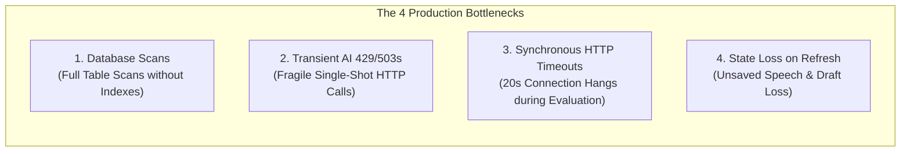
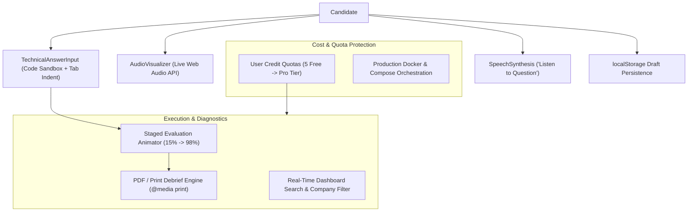

# OfferPrep: The Engineering Journey & Architectural Story

> *A developer's narrative on designing, breaking, and scaling an AI-powered technical interview simulation platform from scratch.*

---

## Executive Summary (The 30-Second Pitch)

**OfferPrep** is a full-stack technical interview simulation platform engineered to solve the "articulation gap" software engineers face during hiring loops. While traditional platforms (LeetCode, HackerRank) train candidates on raw problem-solving in silence, real-world tech interviews test vocal articulation, architecture trade-offs, and communication under strict time limits.

OfferPrep bridges this gap by simulating realistic on-site rounds with speech-to-text input, interviewer text-to-speech playback, live audio waveform visualizers, an interactive code sandbox with Tab-indentation, forward-only interview state machines, company-specific hiring rubrics (Google, Amazon, Meta, Microsoft), resume-personalized questions, and adaptive technical follow-up probes.

This document tells the story of how OfferPrep evolved from a naive prototype into a resilient, production-hardened platform—the architectural walls we hit, the trade-offs we navigated, and how we solved them.

---

## Act 1: The Inciting Incident (The Problem with Tech Prep)

### The Observation
Every year, thousands of brilliant software engineers fail interviews at top-tier companies. It is rarely because they don't know how to code. It is because:
1. **The Articulation Freeze**: Solving a problem in an IDE is fundamentally different from speaking through distributed system trade-offs out loud to another human engineer.
2. **The Lack of Time Pressure in Prep**: Solving a problem in 45 minutes on a weekend is easy; synthesizing a distributed rate limiter in 3 minutes while the clock is ticking induces panic.
3. **Static Question Banks**: Static LeetCode lists cannot challenge a candidate when they gloss over edge cases or make questionable technology choices.
4. **Vague Feedback**: In the real world, rejection emails say: *"While your background is impressive, we decided to move forward with other candidates."* Candidates never learn whether they failed on technical depth, communication structure, or missing edge cases.

### The Mission
Build an interview platform that acts like a real **Principal Engineering Hiring Manager**:
- It speaks the question aloud using natural voice synthesis.
- It visualizes microphone volume to verify voice capture.
- It provides a code sandbox with Tab indentation for algorithms and systems.
- It enforces real-world countdown timers.
- It doesn't let you edit past answers (forward-only).
- It challenges your specific claims with follow-up probes.
- It grades you with an objective, multi-dimensional rubric (Technical, Communication, Completeness, Readiness Score, and Skill Gaps).

---

## Act 2: The Naive Prototype & The Reality Check

Like most initial AI projects, OfferPrep started as a fast prototype:
- **Frontend**: Next.js with a basic form and a `<textarea>`.
- **Backend**: Express router calling Google Gemini API directly.
- **Database**: PostgreSQL with Prisma.

### The First Failure: "The AI Wrapper Trap"
Within 48 hours of testing, the prototype hit three painful realities:

1. **The "AI Slop" Aesthetic**:
   - The UI was loaded with purple neon gradients, sparkle icons (`✨`), and marketing fluff like *"Supercharge Your Interview with AI Magic"*.
   - Feedback from engineers was immediate: *"This looks like a cheap AI wrapper, not a tool I'd trust to prepare for a $250k Google interview."*
   
2. **The Network Font Flash (FOUT)**:
   - Reliance on remote Google Fonts caused rendering delays and jarring font swaps during Turbopack hot-reloads and offline development.

3. **Fragile AI Calls**:
   - A single Gemini rate limit or markdown backtick in the JSON response would crash the entire backend with an unhandled 500 error.

We had to stop building features and start building an **engineering system**.

---

## Act 3: The 4 Architectural Walls (The Engineering Battles)

As we pushed the platform toward real user testing, four critical architectural bottlenecks emerged:



### Wall 1: The Database Bottleneck (Full Table Scans)
- **The Problem**: In PostgreSQL, foreign keys defined in Prisma (`userId`, `sessionId`) do **not** automatically create database indexes.
- **The Consequence**: When fetching a user's interview history (`/api/interviews/analytics`), the database performed a sequential table scan across all rows. At 50,000 sessions, this would spike DB CPU to 100% and cause 5-second query latencies.
- **The Fix**: Added compound B-Tree indexes:
  - `InterviewSession`: `@@index([userId])`, `@@index([status])`, `@@index([createdAt])`
  - `Question`: `@@index([sessionId])`, `@@index([sessionId, order])`
  - Query time dropped from $O(N)$ linear scans to $O(\log N)$ instant index seeks.

### Wall 2: Transient AI Hiccups & The JSON Parsing Trap
- **The Problem**: Large language models occasionally wrap JSON in markdown blocks (````json ... ````), leave trailing commas, or return HTTP 429 rate limits during peak global traffic.
- **The Fix**:
  - Engineered `callWithRetry()`: An exponential backoff retry mechanism with randomized jitter (`baseDelay * 2^(attempt-1) + jitter`), retrying up to 3 times before failing.
  - Engineered `cleanAndParseJSON()`: A regex-based sanitizer that strips markdown fences, extracts the outermost JSON boundaries, and fixes trailing commas before running `JSON.parse`.

### Wall 3: The Zero Data Loss Dilemma (Browser Crashes & Accidental Refreshes)
- **The Problem**: Candidates answering complex architecture questions often speak or type for 3 to 4 minutes. If their browser tab crashed, or they accidentally swiped back, their entire answer was lost.
- **The Fix**:
  - Implemented continuous client-side draft persistence via `localStorage` keyed by `${sessionId}_${questionIndex}`.
  - On page mount or re-connection, the room automatically detects and restores the active draft.
  - The draft is purged only after the backend returns HTTP 200 confirming the response was persisted to PostgreSQL.

### Wall 4: The Identity Sync Race Condition
- **The Problem**: We used Clerk for authentication and PostgreSQL for application state. During initial user signups, network latency could cause the frontend to request session creation before the Clerk webhook had finished writing the user record to PostgreSQL (`Foreign key constraint failed on userId`).
- **The Fix**:
  - Switched from naive `prisma.user.create()` to an idempotent `prisma.user.upsert()`.
  - Added just-in-time fallback user creation in the interview creation endpoint if the webhook was slightly delayed.

---

## Act 4: The 5-Tier Feature Evolution

The platform was engineered in five deliberate tiers, each solving a specific candidate pain point:

```
[Tier 1: Foundations]   --> TypeScript strict types, Sonner toast notifications, centralized API client.
[Tier 2: Core UX]       --> Per-question countdown timers (2m/3m/5m), Difficulty badges (EASY/MED/HARD), Q&A reviews.
[Tier 3: Polish]        --> Dark mode with next-themes, dual celebratory confetti bursts, high-contrast tokens.
[Tier 4: Resilience]    --> Zod schema validation, express-rate-limit protection, React Error Boundary shields.
[Tier 5: Elite Prep]    --> Company tracks (Google/Amazon/Meta), Resume personalization, Adaptive Follow-up Probing.
```

### Deep Dive: How the Adaptive Probe Works
A real interviewer doesn't just read the next question off a sheet. If you say:
> *"I would use Redis as a cache in front of PostgreSQL to handle high traffic."*

A Staff Engineer immediately asks:
> *"What happens during a cache avalanche if your Redis master crashes? How do you prevent your database from collapsing under the thundering herd?"*

To emulate this, we built **Adaptive Probing**:
1. When the candidate provides their partial answer, they can click `Request Follow-up Question`.
2. The backend calls Gemini with the original question, candidate's transcript, and seniority level.
3. Gemini generates a targeted technical probe targeting the trade-offs or assumptions made.
4. The probe is dynamically inserted into the database session as an active question (`isFollowUp: true`) and increments the interview order on the fly.

---

## Act 5: The Aesthetic Overhaul (Killing the "AI Look")

In late iterations, we made an intentional design decision: **Eliminate all AI aesthetic tropes.**

| Cliché AI Pattern | What We Changed It To | Why |
|---|---|---|
| Neon gradient text (`from-blue-600 via-indigo-600 to-purple-600`) | Solid high-contrast text (`text-neutral-900 dark:text-neutral-100`) | Matches professional engineering tools (Linear, Stripe, Raycast). |
| Sparkle icons (`✨`, `Sparkles`) | Functional icons (`CheckCircle2`, `Sliders`, `CornerDownRight`, `Code2`) | Sparkles signal "cheap wrapper"; clean icons signal precision software. |
| "AI Interview Coach" / "AI Magic" | "Practice Workspace" / "Structured Debrief" | Speaks the language of senior engineers, not marketing copy. |
| External Google Fonts | Native System Font Stack (`-apple-system, BlinkMacSystemFont, "Segoe UI"...`) | Zero latency, no network dependencies, razor-sharp on Retina/4K displays. |

---

## Act 6: The Gigantamax Evolution (Achieved Milestones)

To elevate OfferPrep from a solid project into a commercial-grade SaaS platform, we executed the **Gigantamax Evolution**:



### 1. Real-Time Audio Visualizer (`AudioVisualizer.tsx`)
- Integrated the browser's native **Web Audio API** (`AudioContext` and `AnalyserNode`).
- Connects directly to candidate microphone stream, measuring real-time Decibel / RMS volume without third-party libraries.
- Renders a 4-bar dynamic pulsing visualizer beside the microphone button, giving candidates real-time visual proof that their microphone is capturing audio.

### 2. Technical Answer Studio & Code Sandbox (`TechnicalAnswerInput.tsx`)
- Solved the **"Tab Indentation Problem"**: Pressing the `Tab` key inside web textareas normally causes the browser to lose focus and jump to the next button. We intercepted keyboard events to insert 2-space indentation at cursor position.
- **Dual-Mode Studio**: Candidates toggle seamlessly between **Explanation Mode** (prose and speech transcription) and **Code Sandbox Mode** (dark-themed monospace code editor).
- **Template Injector**: Injects boilerplate schemas and starter algorithms for **TypeScript**, **Python**, **Go**, **Java**, and **SQL**.
- **Real-Time Status Bar**: Displays live line counts, character counts, and one-click clipboard copying.

### 3. Interviewer Voice Synthesis ("Listen to Question")
- Built using native **Web Speech Synthesis API** (`SpeechSynthesisUtterance`).
- Candidates can click **"Listen to Question"** to hear the question read aloud in an authentic interviewer cadence ($0.95\times$ speed, $1.0$ pitch).
- Automatically halts playback when moving between questions or submitting answers.

### 4. Staged Diagnostic Progress Engine
- Replaced static loading spinners with an animated 5-stage progress indicator:
  1. `15%` *Transcribing answers & validating response completeness...*
  2. `35%` *Calibrating technical accuracy against engineering rubrics...*
  3. `60%` *Evaluating communication structure & trade-off clarity...*
  4. `80%` *Synthesizing skill gap matrix & readiness score...*
  5. `95%` *Finalizing comprehensive candidate debrief...*

### 5. Monetization & Credit Quota Infrastructure
- Extended the Prisma `User` model with `tier` (`FREE` / `PRO`) and `interviewCredits` (`default: 5`).
- The backend enforces simulation quotas: Free tier users are capped at 5 full simulations before requiring Pro upgrades (`403 Forbidden` with `QUOTA_EXCEEDED`).
- Session creation decrements credit counters atomically.
- The UI surfaces remaining credits (`5 / 5 Credits Left` or `Pro Unlimited`).

### 6. One-Click PDF & Print Debrief Export
- Integrated a **"Print / PDF Report"** export in the evaluation dashboard.
- Custom `@media print` CSS strips out navigation bars, buttons, and dark overlays to generate an A4/Letter formatted report for offline review.

### 7. Dashboard Search & Company Filter
- Added instant full-text search across past interview roles, companies, and seniority levels.
- Added company pill filters (`ALL`, `Google`, `Amazon`, `Meta`, `Microsoft`, `General`) for rapid lookup.

### 8. Production Docker Orchestration
- Multi-stage `backend/Dockerfile` with production asset optimization, healthcheck probes, and non-root execution.
- Root `docker-compose.yml` linking PostgreSQL and the API gateway for 1-click cloud deployments.

---

## Act 7: The Enterprise Horizon (100k+ Distributed Scale)

For enterprise-scale deployments with hundreds of thousands of concurrent users:

1. **Asynchronous Job Queues (BullMQ + Redis)**:
   - Offload long-running evaluation generations from the synchronous HTTP request cycle to background worker pods.
2. **Server-Sent Events (SSE) Streaming**:
   - Stream question text and evaluation debriefs character-by-character as they are generated by the LLM.
3. **Cross-Browser Audio Recording (MediaRecorder + Whisper)**:
   - Provide an automatic fallback audio pipeline for non-Chromium browsers (Firefox, Safari on iOS).
4. **Database Connection Pooling (PgBouncer / Prisma Accelerate)**:
   - Manage thousands of concurrent serverless lambda connections without socket exhaustion.

---

## The Interview Talking Points (STAR Method Cheat Sheet)

Use these concrete talking points when answering common engineering interview questions about OfferPrep:

### Q1: "Tell me about a complex project you designed and built."
> *"I designed and built **OfferPrep**, a full-stack technical interview simulation platform that bridges the articulation gap for software engineers. The platform combines Next.js 16, Express, PostgreSQL with Prisma, Clerk authentication, and Google Gemini. Unlike static question banks, it acts as an interactive interviewer: it vocalizes questions via Speech Synthesis, visualizes mic volume in real time using Web Audio API, provides an in-browser code sandbox with Tab-key indentation, enforces per-question countdowns, supports company-specific tracks (like Amazon's Leadership Principles or Google's algorithmic focus), and uses adaptive prompting to generate challenging follow-up probes based on the candidate's actual answers. I also built a multi-dimensional diagnostic evaluation engine that benchmarks candidates with an objective readiness score and skill gap matrix."*

### Q2: "What was the most challenging technical problem you solved?"
> *"Handling AI reliability and latency at the API boundary. In early versions, evaluating a 5-question interview took 15-20 seconds. If the user hit a transient 429 rate limit or Gemini returned markdown-wrapped JSON with unescaped control characters, the request would crash with an unhandled 500 error. I solved this by engineering an internal resilience layer: first, I built an exponential backoff retry mechanism with randomized jitter to absorb transient rate limits; second, I implemented a custom regex-based JSON sanitizer that strips markdown fences and fixes trailing commas before parsing; and third, I restructured the database schema with compound B-Tree indexes on foreign keys to eliminate sequential scans during analytics aggregation."*

### Q3: "How did you handle edge cases, state management, and developer experience?"
> *"One major edge case was candidate state loss. During a timed 3-minute answer, if a candidate accidentally refreshed the page or lost internet connection, their entire spoken transcript was lost. I designed a local-first draft persistence mechanism using `localStorage` keyed by session ID and question index. The draft automatically restores if the page reloads, and is only purged when the backend confirms an atomic HTTP 200 persistence to PostgreSQL. For the coding rounds, standard web textareas lose focus when pressing the Tab key; I built a custom technical editor that intercepts Tab events to insert 2-space indentation cleanly. Additionally, I enforced a strict forward-only state machine so candidates cannot revisit or modify past answers, authentically replicating high-pressure on-site interview conditions."*

### Q4: "How did you approach design and user experience?"
> *"I took inspiration from developer-first products like Linear and Stripe. A lot of modern AI tools suffer from what I call 'AI Slop'—neon rainbow gradients, sparkle emojis everywhere, and cheesy marketing buzzwords that turn off senior engineers. I completely stripped out those tropes: I established a system-native font stack that eliminates font-loading network latency, implemented high-contrast neutral slate palettes with seamless dark mode support, and replaced marketing jargon with grounded engineering terminology like 'Technical Probe', 'Session Parameters', and 'Readiness Benchmark'."*

### Q5: "How did you handle cost management, abuse prevention, and production readiness?"
> *"Because LLM inference carries direct API costs, protecting against abuse and bot spam was critical. I implemented a multi-layered defense: first, global and AI-specific IP rate limiting via `express-rate-limit`; second, strict input validation schemas using Zod; and third, a database-level credit quota engine where Free tier candidates receive 5 full simulation credits, with automatic decrements upon session creation. Once credits reach zero, the API returns a clean 403 response prompting an upgrade. For infrastructure, I built a container-grade `/health` endpoint that pings PostgreSQL directly, wired graceful shutdown hooks for SIGTERM/SIGINT, and authored multi-stage Dockerfiles and docker-compose orchestration for reproducible cloud deployments."*

---

## Architectural Summary Table

| Category | Technology / Pattern | Engineering Rationale |
|---|---|---|
| **Frontend Framework** | Next.js 16 + React 19 | Server-side rendering, client routing, Turbopack compilation. |
| **Styling & Design System** | TailwindCSS v4 + Native System Fonts | Zero runtime CSS overhead, crisp typography across all operating systems. |
| **Authentication** | Clerk (`@clerk/nextjs`, `@clerk/express`) | Secure JWT session management with server-side signature verification. |
| **Backend API** | Node.js + Express 5 + TypeScript | Lightweight, fast I/O, strict end-to-end type safety. |
| **Database & ORM** | PostgreSQL + Prisma ORM | Relational data integrity, cascade deletions, compound B-Tree indexing. |
| **AI Inference** | Google Gemini 2.5 Flash | High-speed, structured JSON schema generation and deep evaluation rubrics. |
| **Voice & Speech Pipeline** | Web Audio API + Speech Synthesis + Speech Recognition | Live mic waveform visualizer, interviewer voice reading, real-time speech transcription ($0 API cost). |
| **Developer Experience** | Code Sandbox (`TechnicalAnswerInput`) | Tab indentation support, language templates (TS, Python, Go, Java, SQL). |
| **Cost & Quota Protection** | Tier Credits + `express-rate-limit` + Zod | Prevents API cost overruns; limits free tier to 5 simulations before Pro. |
| **Reliability Engineering** | Exponential Backoff Jitter + Draft Autosave | Handles 429 rate limits gracefully and prevents candidate data loss on refresh. |
| **Deployment & Orchestration** | Docker + Docker Compose + Healthchecks | Multi-stage production containerization with active database ping probes. |
